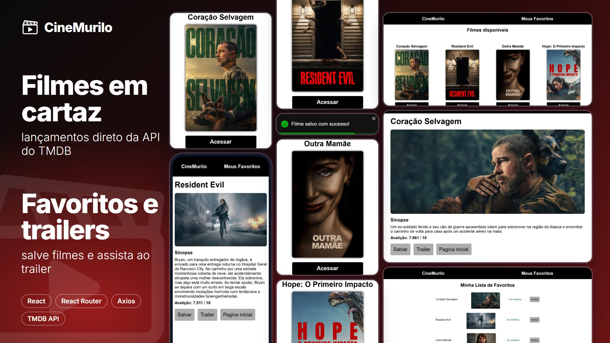
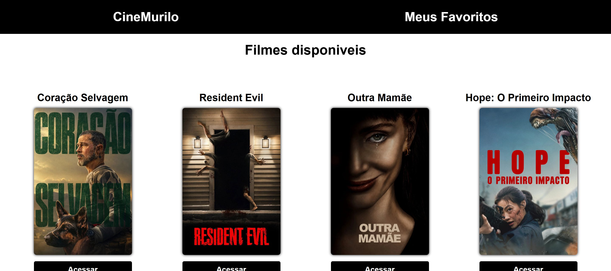
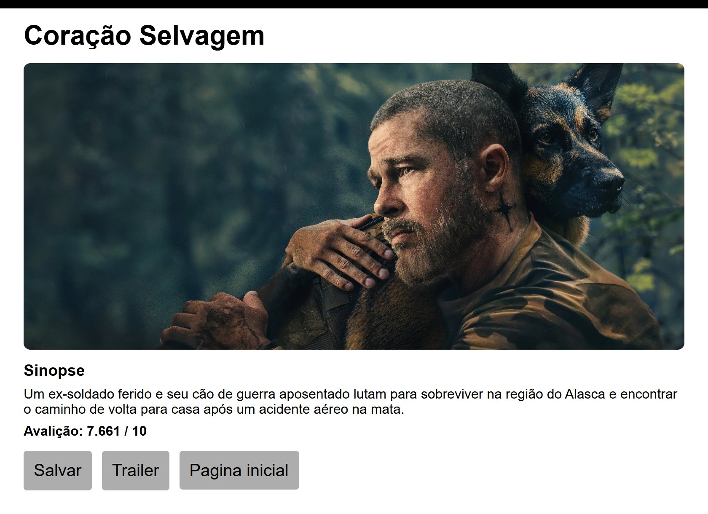
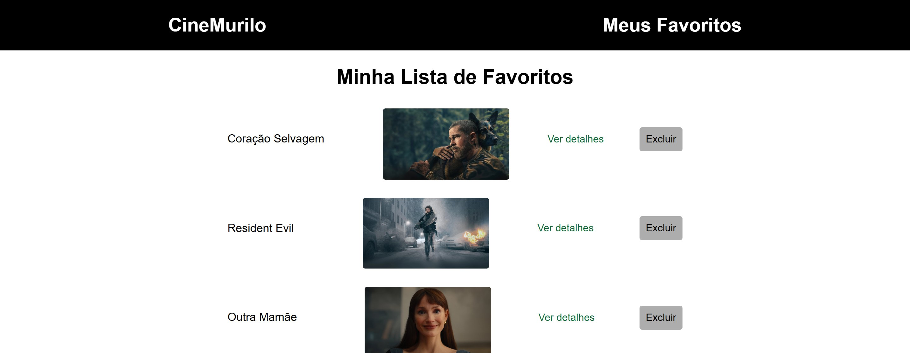

<h1 align="center">🎬 Cine Murilo</h1>

<p align="center"><em>Busca de filmes recém-lançados, com favoritos e trailers.</em></p>

<p align="center">
  
</p>

<p align="center">
  <a href="https://cine-murilo.vercel.app"><strong>🔗 Ver online</strong></a> ·
  <a href="#-sobre">Sobre</a> · <a href="#-funcionalidades">Funcionalidades</a> · <a href="#-tecnologias">Tecnologias</a> · <a href="#-como-rodar">Como rodar</a> · <a href="#-contato">Contato</a>
</p>

<p align="center">
  
  
  
</p>

---

## 💻 Sobre

Este projeto foi desenvolvido durante o curso do **Sujeito Programador** e marcou um passo muito importante no meu aprendizado.

Ele reforçou conceitos fundamentais de **frontend** e do uso do **React JS** para criar aplicações modernas.

> **Tipo:** projeto de estudo · **Ano:** 2025 · **Online:** [cine-murilo.vercel.app](https://cine-murilo.vercel.app)

## ✨ Funcionalidades

- Lista de filmes recém-lançados vinda da API do TMDB.
- Favoritos salvos no próprio navegador.
- Trailer do filme.
- Avisos na tela quando algo dá certo, como remover um favorito.

## 🎯 Dores que resolve

- Descobrir o que está em cartaz sem sair de um só lugar.
- Guardar os filmes que quero ver depois, sem criar conta.

## 💼 Tecnologias


| Tecnologia | Para que usei |
| --- | --- |
| **React** | Lógica e funcionamento da aplicação, em componentes. |
| **React Router** | Navegação entre início, filme, favoritos e página de erro. |
| **Axios** | Chamadas à API do TMDB. |
| **React Toastify** | Mensagens de confirmação na tela. |
| **CSS3** | Estilização e design da interface. |
| **API do TMDB** | Fonte dos filmes em cartaz e dos pôsteres. |

<sub>Este produto usa a API do TMDB, mas não é endossado nem certificado pelo TMDB.</sub>

## 📸 Telas

<table>
  <tr>
    <td width="33%" align="center" valign="top"><br /><sub>Catálogo de filmes</sub></td>
    <td width="33%" align="center" valign="top"><br /><sub>Página do filme</sub></td>
    <td width="33%" align="center" valign="top"><br /><sub>Lista de favoritos</sub></td>
  </tr>
</table>

## 🚀 Como rodar

```bash
git clone https://github.com/MuriloRocha-01/CineMurilo.git
cd CineMurilo
npm install
npm start          # abre em http://localhost:3000
```

Outros comandos: `npm run build` (versão de produção) e `npm test`.

## 🗂 Estrutura do projeto

```text
src/
├─ Components/Header   cabeçalho com os links
├─ pages/              Home, Filme, Favoritos e Erro
├─ services/api.js     cliente da API do TMDB (Axios)
├─ routes.js           rotas (React Router)
└─ img/                imagens
```

## 🛠 Desafios enfrentados

- ✅ **useState** → armazenar estados (filmes buscados e favoritos)
- ✅ **useEffect** → lidar com ciclos de vida e carregar dados automaticamente
- ✅ **Responsividade** → garantir funcionamento em diferentes dispositivos
- ✅ **Loading** → feedback visual ao usuário durante buscas
- ✅ **Tratativas de erros** → mensagens claras caso o filme não seja encontrado
- ✅ **Consumo de API** → integração com dados externos para exibir filmes recém-lançados

## ✨ Conclusão

Esse projeto é muito especial, pois representa meu **primeiro passo prático como desenvolvedor web**. Ele me motiva a seguir evoluindo todos os dias no mundo da programação. 💻🚀

## 🧭 Próximos passos

- [ ] Campo de busca por nome do filme
- [ ] Paginação ou botão "carregar mais" no catálogo
- [ ] Favoritos ligados a uma conta (hoje ficam só neste navegador)

## 📬 Contato

Disponível para freelas e novas oportunidades, **#OpenToWork** 🚀  
📧 [murilorochadelima.10@gmail.com](mailto:murilorochadelima.10@gmail.com) · 💼 [LinkedIn](https://www.linkedin.com/in/murilo-rocha-6706a41aa/) · 🐙 [GitHub](https://github.com/MuriloRocha-01) · 🌐 [Portfólio](https://oficial-portifolio-six.vercel.app)

---

<p align="center">Feito com 💙 por <a href="https://github.com/MuriloRocha-01">Murilo Rocha</a></p>
